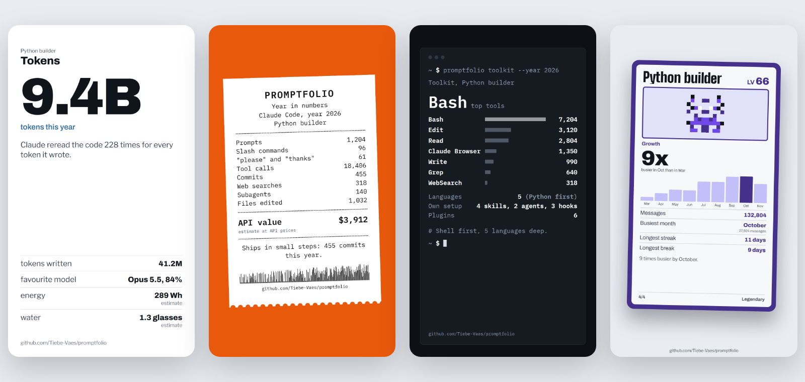
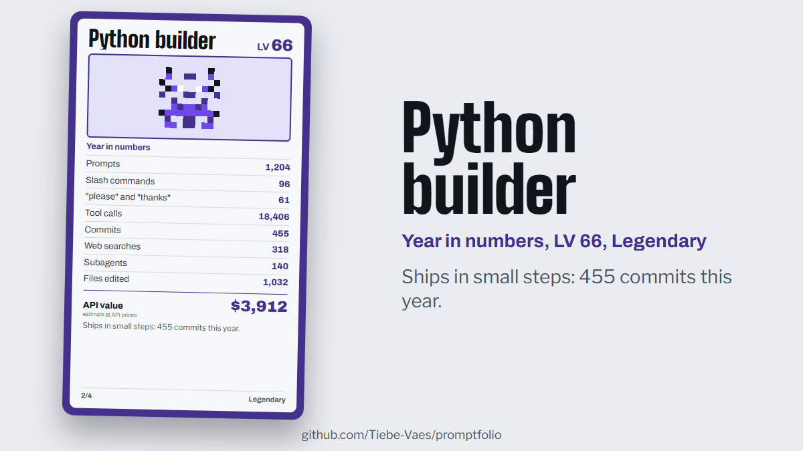

# Promptfolio

**Your year with Claude Code, as a recap you can post.** Promptfolio reads your local Claude Code logs, works out your year in numbers, and turns it into four share cards with a line from Claude on each, based on what you actually did. Nothing leaves your machine except what Claude reads in your own session.



*Sample output made with invented demo data.*

## Install

In Claude Code:

```bash
claude plugin marketplace add Tiebe-Vaes/promptfolio
claude plugin install promptfolio@promptfolio
```

Or with the skills CLI:

```bash
npx skills add Tiebe-Vaes/promptfolio
```

Then type `/promptfolio`. Pick **Make it now** for the defaults, or **Personalise** for five quick taps: style, tone, formats, cards and colour.

Needs Node 18.3 or newer. Claude Code's native installer does not install Node, so check with `node -v`.

## What you get

Four cards, all in the style you pick:

| Card | What is on it |
|---|---|
| **Tokens** | Tokens this year, tokens Claude wrote, your favourite model, energy and water estimates |
| **Year in numbers** | Prompts, slash commands, "please" and "thanks", tool calls, commits, web searches, subagents, files edited, with the API value as the total |
| **Toolkit** | Your top 10 tools, your languages, the skills, agents and hooks you built, your plugins |
| **Growth** | Messages per month, how much busier you got, your busiest month, longest streak and longest break |

- **Four styles:** Clean, Receipt, Terminal and Trading card (the four cards become a booster pack).
- **Four colours:** your top language's colour, Ink, Grape or Sunset.
- **Three tones:** Professional (each line a habit with its number), Fun, or Roast me.
- **The formats you pick:** Story 9:16 (1080x1920), Square 1:1 (1080x1080), Wide 16:9 (1200x675) and a GitHub README banner (1200x400). Rendered with the Chrome, Edge or Brave you already have; only what you pick is rendered.
- **A tap-through story** (`story.html`, opens offline) with all four cards.
- **A share step:** a caption per platform, X opens a prefilled post, and you post it yourself.



Everything is in English. Every number in the text comes from code, never from the model: Claude writes `{tools.commits}` and Promptfolio fills in the value, so the numbers are always right.

## Privacy

- **The scripts make no network requests.** A test (`tests/offline.test.ts`) fails the build if network code appears.
- **What is read:** `~/.claude/stats-cache.json`, `~/.claude/history.jsonl`, `~/.claude/projects/**/*.jsonl`, and counts from `~/.claude/skills`, `agents` and `settings.json`. Set `CLAUDE_CONFIG_DIR` to use another folder.
- **What Claude sees:** a redacted `stats.json` and `sample.json`. Project names become "Project A, B, C" and never reach a card, paths never leave, and a secret scan drops anything that looks like a key, token or email. Prompt text is counted, never copied.
- **Where output goes:** `./promptfolio-<year>/` in your current folder.

## Good to know

- **Detailed stats cover about 30 days.** Claude Code deletes full session logs after 30 days by default (`cleanupPeriodDays`). Year-wide counts come from its own daily summary; tokens, tools and commits come from the logs still on disk. Promptfolio says which period each number covers and offers to raise the setting so next year is complete.
- **Equivalents are estimates.** Anthropic publishes no energy or water figure per prompt, so energy and water use Google's published Gemini figure, labelled as such.
- **Not affiliated with Anthropic.** Promptfolio is an independent open-source project.

## Development

```bash
npm install
npm test
npm run build   # bundles src/cli into plugins/promptfolio/skills/promptfolio/scripts
```

Development needs Node 22.12+. The shipped scripts have no dependencies and run on Node 18.3+; CI checks both.

## License

[MIT](LICENSE)
